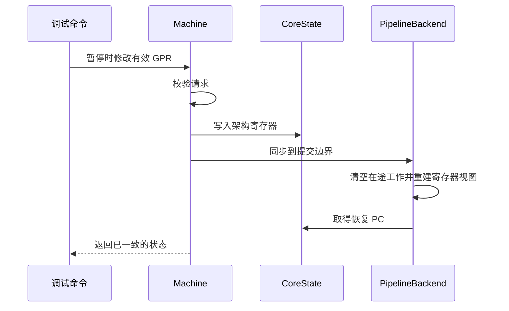

# 系统软件模拟器可信度修复 - Plan

## Goal Capsule

Objective：修复已取证的页表写回、暂停修改寄存器和参考验证夹具问题，使后续系统软件调试建立在可信的执行与验证边界上。

Means：三个独立修复单元与一次整合验收，复用既有最小复现并转为长期回归。

权威顺序：用户最新决定、AGENTS.md、本计划的 Product Contract、取证报告和现行实现。既有行为与规范矛盾时保留证据，不通过放宽断言消除失败。扩大到新产品能力或无法局部修复的问题时，回传影响与建议，不擅自重写系统。

## Product Contract

### Summary

本计划交付三项可信度修复及可复核的验证结果。用户另开会话实施，继续使用 `codex/system-software-evidence-plan` 分支。

### Problem Frame

第一份取证计划已验证固定 xv6、functional、单 hart 下的普通 fork、两页隔离与 exit/wait，同时发现两处产品缺陷和一处参考夹具缺陷。观察与解释能力建设需要可靠基础；当前证据不支持整体重写，也不证明这些缺陷已阻断普通 xv6 fork。

### Requirements

R1. MMU 更新 A/D 位时，不能把缓存中的旧映射或权限覆盖回当前页表；发现当前 PTE 已变化时，重新完成适用的翻译与权限检查。覆盖 F-U3-002。

R2. 暂停时成功修改 GPR 后，可见架构状态与恢复执行使用的状态一致；修改过程不执行客体指令、不推进 cycle/instret/mtime、不新增设备访问，已提交效果保留。覆盖 F-U3-001。

R3. 参考夹具具有双方明确、有限的停止边界，原委托场景及四项 Sv39 fault 场景能够完成真实 Spike 对照；保留被验证的异常、委托与返回语义。覆盖 F-U2-001，后四项逐项诊断，不预设同因。

R4. 三项修复均有能暴露原错误的长期自动回归；工具自测、真实参考和系统软件实验分别报告，未运行与失败不记为通过。

R5. 在修复后的组合版本上复验既有普通 fork 场景，提供逐问题的修复、验证、剩余边界与后续建议，作为下一轮可观察性计划的输入。

### Key Decisions

- 本轮只修上述可信度问题，观察接口与 xv6 调试呈现另行规划。Governs R1–R5。(session-settled: user-approved — chosen over 立即建设完整调试场景或整体重构: 先修复已证实边界，再建设能力)
- 继续当前分支，不切回 main、不因其他会话合并 PR 自动变基。Governs R4–R5。(session-settled: user-directed — chosen over 新建分支: 用户要求在本分支续作，取证提交可直接追溯)

### Scope Boundaries

允许修改必要的 CPU/MMU、后端同步、平台调试入口与测试夹具，允许将快速回归接入现有默认验证目标。生产行为变化须更新对应 Wiki 契约；Wiki 在独立仓库维护，未发布状态记录到 current。

本轮不实现纯查询 API、事件持久化、PID 自动解释、前端时间线、COW、多 hart、Linux、AI、JIT/OoO 扩展或真实性能标定。不以修夹具为由修改标准 S/U ECALL 行为。未授权推送、创建 PR、合并或发布 Wiki；交付本地代码与文档后回传。

#### Deferred to Follow-Up Work

纯查询与执行访问分离、访存事件关联与丢失信号、固定 xv6 适配、受控故障定位演示，以及启动耗时优化，均保留给后续计划。

### Sources

- [第一份计划](2026-10-02-1038-system-software-evidence-plan.md)、[最终取证回传](../reviews/system-software-evidence-c253dda-u5.md)。第一份计划已经完成，本文件是新的修复交付，不覆盖历史证据。
- [U2：一致性与参考夹具](../reviews/system-software-evidence-c253dda-u2.md)、[U3：观察与 MMU](../reviews/system-software-evidence-c253dda-u3.md)、[U4：普通 fork](../reviews/system-software-evidence-c253dda-u4.md)。规范依据沿用 U2/U3 指定版本，特别是 U3 引用的 Privileged 20240411 §10.3.2；实施时对照原文确定检查与重试边界。
- [xv6 工具链与预算经验](../solutions/build-errors/xv6-ci-toolchain-baselines-and-budget.md)。不同编译器的基线不可混用，不根据实际输出重新生成期望。

---

## Planning Contract

规划基点：`b3831060b30a96d2dcd4f509154fb64166eeb3be`。该分支已有取证提交；本计划编写期只阅读源码与证据，不构建、不运行产品测试。沿用上游调研，补查后端清空/重建入口、参考 runner 与 Makefile，不重复全仓研究。

### Key Technical Decisions

KTD1. 在 AddressSpace 的共同 A/D 更新路径解决 R1，区分更新成功、PTE 已变化需重试和总线失败。不能只在调试查询入口 flush TLB，也不能仅对新 PTE 按位 OR 后继续使用旧 PA。当前单 hart 同步执行模型内，比较与写回之间不得推进客体或调用可重入执行；不引入未需要的宿主多线程锁框架。

KTD2. 暂停 GPR 修改以已提交的 CoreState 为恢复边界：丢弃未提交流水线工作，从架构 PC 重新取指，并同步重命名和物理寄存器视图。复用 `PipelineCoreState::flush` 与 `rollback_to_committed_state` 的职责，必要时增加窄范围后端同步钩子。仅调用 `flush` 不会清空 ROB/LSQ；整体 `rebuild_backend` 会丢失历史状态，不作为默认修复。

KTD3. R2 中已提交 RAM/MMIO、计数器、设备状态、退休记录与累计 profile 保留，序列号不倒退或复用；调试修改本身不伪装成退休或 trap。已发生的推测 cache/TLB/A 位效果不承诺逆转。清空在途工作会改变后续模型周期，属于显式调试干预，不承诺与未修改运行逐周期相同。非法寄存器或未加载镜像先校验后失败，不先清空流水线；x0 写入保持无效果。

KTD4. 参考程序使用独立的 M 退出处理或双方等价的显式停止协议，保留被测 S handler 和首异常信息。比较点放在有定义的语义边界；退出脚手架造成的最终特权级或 CSR 差异须逐字段说明。不得扩大 mask、屏蔽失败场景或仅增加步数上限以获得匹配。

KTD5. 历史证据保持历史含义；不要把证明旧缺陷的输出改成新版本通过证据。将核心断言迁入既有回归或独立的小型测试，新建修复报告记录新输出。原取证探针若带旧行为断言，只作为历史复现使用，不要求它在修复后保持原输出。

### Assumptions and Deferred Questions

- 当前仍是单 hart、同线程逐步执行。无需实现宿主并发页表原子操作或跨 hart shootdown；若调用链证实存在并发写入，先修订 KTD1，再实施。
- 后四项参考失败的具体原因留给 U3 的有界诊断；同类夹具问题可一并修复，发现新的 ISA 缺陷则记录独立问题，不自动扩大生产修复范围，也不宣布 R3 完成。
- 后端同步钩子的具体名称、PTE 重试结果类型由实施决定，以上行为契约不推迟。若必须破坏已提交状态才能同步，属于方案反证，应回传而非降低 R2。
- 开工记录实际 HEAD、工作区差异和工具版本。仅文档变动不使旧产品证据失效；本轮代码变化后，旧 xv6 成功记录不替代组合版本复验。

<!-- nk-section: work-relationships -->
### Work Relationships

U1 → U2 → U3 → U4 顺序执行，减少共享源码与镜像干扰。U1–U3 分别独立提交；U4 汇总组合验证和统一审查。U-ID 属于本计划，提交信息带 `fix(mmu)`、`fix(debug)`、`fix(validation)` 等范围，避免与旧取证计划的同号单元混淆。

工作区已有其他会话对 `docs/current.md`、`docs/reviews/2026-10-01-pr14-17-pre-merge.md` 的修改及未跟踪的 `docs/reviews/2026-10-01-remote-pr-pre-merge.md`。保留这些内容，current 只提交本计划自己的差异；不以清理工作区为由 stash、覆盖或夹带外来改动。

---

## Implementation Units

### U1. 修复 MMU A/D 写回与重试

**Goal / Requirements：** 消除 F-U3-002，满足 R1、R4；无前置实施单元。

**Files：** `myCPU/src/mem/address_space.{h,cpp}`；需要原子访问边界时涉及 `myCPU/src/mem/bus.{h,cpp}`；回归首选 `myCPU/tests/host/address_space_faults_smoke.cpp`，以及 `myCPU/tests/asm/sv39_tlb_ad_bits.S`、`sv39_tlb_flush.S`；参照 `myCPU/tests/host/system_software_observation_evidence.cpp`。测试注册涉及 `myCPU/Makefile`。

**Approach：** 按 KTD1 修共同路径，失配后丢弃相应旧翻译并重新检查当前页表；新表项无效、权限拒绝或读写失败时返回对应异常，不使用旧 PA 完成访问。参照现有 result/fault 返回写法，避免异常信息或失败地址丢失。

**Execution note：** 先用最终保存的复现和控制组建立失败回归，再修改产品；不能用“未 fence 所以任何结果都允许”解释 PPN 被覆盖。

**Test scenarios：**

- 相同有效 PTE：load 设置 A，store 设置 A/D，PPN/权限保持；已具备相应位时无多余写回。
- 旧映射 A、A/D 未齐，填 TLB 后改为 B：触发 A/D 更新，B 的 PPN 不被旧值覆盖；按 KTD1 重查后使用 B，flush 后仍使用 B。
- A 已置、D 未置，填 TLB 后改映射再 store：不能漏掉只需更新 D 的路径，不能向旧页面提交写入。
- 缓存表项后撤销权限或使 PTE 无效，再触发更新：重查得到当前权限/页故障，不改用户数据；PTE 读失败或更新写失败返回适用 access fault。
- 无预查询、提前 sfence 的控制组，以及双方后端的现有 TLB/A-D guest 场景继续通过。未触发 A/D 更新且没有 fence 的普通陈旧翻译不强制改成即时一致。

**Verification：** 执行 V1；报告旧版本失败与修复后通过的具体断言、PTE/PA/异常变化。需要补充 fault 注入时复用现有测试 Bus/Device 模式，不添加产品调试后门。

### U2. 修复暂停 GPR 修改后的后端一致性

**Goal / Requirements：** 消除 F-U3-001，满足 R2、R4；在 U1 之后实施。

**Files：** `myCPU/src/platform/machine.{h,cpp}`、`myCPU/src/exec/backend.h`、`functional_backend.{h,cpp}`、`pipeline_backend.{h,cpp}`、`pipeline_core_state.{h,cpp}`；必要的调用适配位于 `myCPU/src/debug/debug_session.cpp`。测试首选 `myCPU/tests/unit/machine_loader_reset.cpp`、`myCPU/tests/host/debug_protocol_command_smoke.cpp`、`pipeline_speculation_contracts_smoke.cpp`，参照观察取证探针；测试注册涉及 `myCPU/Makefile`。

**Approach：** 按 KTD2/KTD3 使 Machine 的受支持 setter 统一触发同步；覆盖 DebugSession、协议和启动初始化消费者，不让每个调用者自行清理后端。功能后端保留简单路径，不给普通 guest GPR 写入添加调试 flush。此次仅承诺 GPR setter，不顺带改所有 CSR/内存调试命令。

**Test scenarios：**

- 加载后 `x5=41`，执行 `addi x6,x5,1` 并写 RAM：functional/pipeline 均得到 42，snapshot 与独立 RAM 结果一致。
- 已退休若干指令、ROB 中仍有依赖旧值的指令时暂停并改值：从架构 PC 恢复，未提交旧计算不覆盖新值，无重复退休或跳过指令。
- 在途 store/MMIO 尚未提交时修改：setter 不产生该副作用；恢复后按新值执行且只提交一次。此前已提交的 RAM/MMIO 效果保持。
- setter 前后 cycle/instret/mtime、累计 profile 和退休历史保持；后续序列号单调，快照不保留假有效的在途槽位。
- x0、寄存器别名、非法名称、未加载镜像及重复修改行为明确；失败请求不改变执行状态。两后端及协议入口均有覆盖。

**Verification：** 执行 V2；既有 rename/commit/speculation 与 profile 测试不得因“重建后端”而被重置期望。必要契约变更同步到独立 Wiki 的相关调试/后端页面，本地修改及未发布状态回传。

### U3. 修复参考退出夹具并恢复真实 Spike 对照

**Goal / Requirements：** 消除 F-U2-001，满足 R3、R4；在 U2 之后实施。

**Files：** `myCPU/tests/host/spike_differential_smoke.cpp`、`myCPU/tests/host/spike_differential/` 下的场景定义、`mycpu_runner.h`、`spike_runner.h` 及必要比较代码；参照 `myCPU/tests/host/system_software_spike_fixture_evidence.cpp`；默认自测注册在 `myCPU/Makefile`，必要时同步 `myCPU/tests/host/ci_targets_test.py`。

**Approach：** 逐项定位五个参考前失败场景的首个分歧，按 KTD4 修夹具。工具自测应无需安装 Spike 即可运行；真实差分保留显式外部入口，不让缺少参考工具成为默认 CI 的隐式通过。

**Test scenarios：**

- 原 U→S 委托、S 返回、最终退出完成，仍验证首异常 cause/epc/tval 与返回效果；S ECALL 不变成产品特殊退出。
- 四项 Sv39 fault 分别验证预期页故障与退出，不从首项通过推断其余同因或通过。
- 原五项已匹配场景继续真实匹配；修改停止边界后核查双方 GPR/CSR/内存的比较时刻。
- 自测完整执行到结束；错误参考输出、非零退出、超时及缺工具仍清晰失败或显式未验证，不能产生匹配结果。

**Verification：** 执行 V3；十项逐项列出 myCPU 是否完成、Spike 是否实际启动、退出码、比较字段和排除理由。若新问题超出夹具范围，保留已完成修复，明确剩余阻断。

### U4. 组合验证、统一审查与回传

**Goal / Requirements：** 在 U1–U3 的组合版本验收 R4、R5，不新增产品功能。

**Files：** 新建 `docs/reviews/system-software-trust-fixes.md` 与必要的小型文本证据目录，更新 `docs/current.md`；复用 `myCPU/tests/host/system_software_fork_evidence.cpp`、`myCPU/tests/guest/system_software_fork_evidence.c` 和原 U4 构建脚本。

**Approach：** 执行 V4 后统一审查三项修复的调用边界、失败路径、测试有效性与范围。对单元已有且仍适用的结果不无故重跑。发现本轮引入的问题修复并补相关验证，再回传。

**Test scenarios：** 组合版本仍能完成普通 fork 的两页继承/隔离、实际 U store、exit/status37/wait、两张子数据页回收及同次 boot 的 forktest；不要求固定 PID、PA、完整时钟数，不更换语义断言以适应错误实现。

**Verification：** 报告每个 F-ID 的前后证据、实际命令与版本、统一审查结论、Wiki 本地路径/提交/发布状态、剩余缺口。明确是否具备进入后续观察能力建设的基础，不将本轮修复描述为完整调试平台交付。

---

## Verification Contract

下面命令从仓库根执行；guest 镜像构建与使用串行。新增回归优先并入已运行的相邻测试，确需独立目标则明确注册到默认 gate，不能仅留下可手动构建的源文件。

| ID | 必需验证入口 | 判据 |
| --- | --- | --- |
| V1 | `make -C myCPU test-host-address_space_faults_smoke test-host-backend_differential_smoke`；`make -C myCPU test-sv39_tlb_ad_bits test-pipeline-sv39_tlb_ad_bits test-sv39_tlb_flush test-pipeline-sv39_tlb_flush` | 新负向断言有效，原权限、A/D、fence 路径通过 |
| V2 | `make -C myCPU test-unit-machine_loader_reset test-host-debug_protocol_command_smoke test-host-pipeline_core_state_smoke test-host-pipeline_rename_commit_smoke test-host-pipeline_speculation_contracts_smoke test-host-pipeline_commit_trace_smoke test-host-execution_profile_smoke test-host-debug_cli_smoke` | 暂停修改与恢复、历史统计和已提交副作用契约通过 |
| V3 | `make -C myCPU test-host-spike_differential_smoke`；真实参考沿用 U2 保存的逐场景 argv，显式指定已记录的 `SPIKE_PATH` | 工具自测完整通过；十个已选场景实际参考对照完成，非 mock |
| V4 | `make -C myCPU test-ci-core`；`make -C myCPU test-host-run_debug_cli_probe`；`make -C myCPU test-host-xv6_boot_smoke test-host-xv6_shell_smoke`；U4 独立 fork 探针按原构建脚本和运行清单重建执行 | 默认 unit/核心 host、默认 Python probe 与系统场景有组合版本证据 |

真实 Spike 当前取证路径为 `/home/liangjiaqi/.local/riscv-spike/bin/spike`，仅是环境线索，开工核对可用性和哈希。单场景沿用原有限预算；若使用批量真实差分入口，其默认 Make 总预算为 3 秒，不能误把它当单场景预算，须依据场景数量设置并记录有限总预算。不能借此扩大 guest 步数掩盖循环。

debug CLI 使用 Make 现行 30 秒预算，不沿用旧取证临时的 15 秒截断。超时记录实际场景与推进证据；原因不清时不得称死锁或直接跳过。xv6 shell 与独立 fork 各保留 1200 秒上限；工具链变动按已有 solution 核对。默认 Python probe 与 xv6 镜像实验不并发；外部资产类 skip 单列。

记录实际代码 SHA、未提交产品差异、源码/ELF/镜像哈希、编译器与参考版本、命令/工作目录、预算、退出码、日志入口。报告不用 JS Number 解析 64 位 SATP。文件证据保留可重建源与命令，不提交二进制或磁盘镜像。

当前本地交付不要求伪造云端验收；之后获准推送并提出 PR 时，`simulator-core` 与 `frontend` 必须在对应实际 checkout SHA 上成功。旧云端结果不替代本次生产修复。局部环境阻断可保留已验单元，但整体完成判据不能降格。

## Definition of Done

三项缺陷的回归和对应行为满足 R1–R4，组合 xv6 场景满足 R5；关键断言可在修复前暴露错误，修复后通过。各单元提交与本计划关联，报告能定位真实参考调用及每项限制。

统一审查已完成，本轮引入的问题已解决；失败、超时、跳过与未运行分别列出。相关 Wiki 契约已在独立仓库形成可审阅修改并注明发布状态；无契约变化的条目说明理由。删除放弃尝试的代码与本轮无用临时脚手架，保留仍被引用的原取证档案及所有外来工作区修改。

规划自检：已核对连贯性、可行性、范围及对抗性边界；重点排除了只 OR 当前 PTE 后继续用旧 PA、仅同步一个物理寄存器、整体重建导致历史丢失，以及放宽参考比较的假修复。无规划期开工阻断；实现期未知及超范围失败的回传规则已明确。本计划不引入新的项目领域术语。
