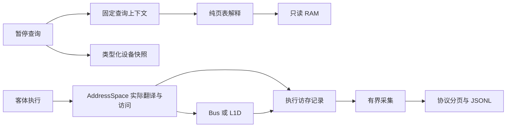
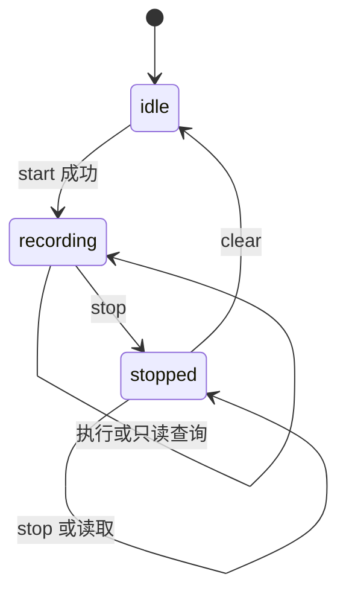

# 可信观察与最小访存采集 - Plan

## Goal Capsule

Objective：使用正式接口，在不改变客体运行结果的前提下查看暂停状态，并取得能够解释普通 xv6 fork 父子写入隔离的有限、可关联、可导出的执行证据。

Means：只读物理内存与页表解释、functional 实际访存记录、有界采集与调试协议，最后迁移既有 fork 探针。

权威顺序：用户最新决定、AGENTS.md、Product Contract、现行实现与既有证据。观察不能为了补字段而重做客体访问。若需要改 ISA 语义、支持新的执行后端或重构整个观察系统，保留证据并回传，不通过伪造字段降低验收。

## Product Contract

### Summary

首版交付两后端暂停时可用的只读查询，以及 functional、单 hart 的访存采集和导出。现有快照、profile 与调试命令保持兼容，普通 xv6 fork 使用正式接口完成证据采集。

### Problem Frame

第二份计划已修复 MMU A/D 写回、暂停 GPR 同步与参考夹具问题，组合版本的真实 Spike 与普通 fork 验证通过。当前阻碍来自观察边界：普通 Bus/helper 读取会影响设备或最新访问记录，`translate_result(..., false)` 仍填 TLB，profile 的事后翻译不等于执行时翻译，短窗口没有完整的保留与丢失说明。

### Requirements

R1. 暂停查询不改变 GPR/CSR/PC、RAM、设备、reservation、TLB/cache 内容与统计、cycle/instret/mtime、profile、最新 Bus 记录或采集记录；成功、失败和重复查询均满足。查询分物理 RAM 字节读取、页表解释、现有设备状态快照，不提供以普通 MMIO load 冒充的通用窥视。

R2. 页表解释支持 Bare/Sv39、当前或显式给定 SATP、有效特权级及 SUM/MXR、访问类型，返回逐级 PTE 的物理位置/原值、叶级别、页大小、映射 PA、权限判定和 A/D 是否需更新。它只解释当前 RAM，不查找、填充或刷新 CPU TLB；无法解析的 PA、不支持的模式、非 RAM 页表及不合法表项明确标记，不能伪造成客体 trap。

R3. functional 的标量整数 load/store、压缩等价指令及 LR/SC/AMO 产生执行访存记录，关联发起时 PC/指令字/特权/SATP、实际 VA→PA 分段、访问值与字节数、结果、异常以及最终退休与否。失败 SC 与部分成功后 fault 均能表达；不可从异常后的 CSR 或重新翻译推断发起上下文。

R4. 支持显式启动、停止、清空、读取的有界采集，配置容量和目标过滤条件。记录只来自运行路径，重复值也保留；查询及导出不消费或追加记录。溢出、过滤、覆盖范围以元数据说明，不无声丢失，不阻塞或停止客体执行。

R5. 提供正式 C++ 调试接口及增量 CLI/JSON 协议，可分页读取和由调用者保存 JSONL。地址、SATP、值、ID、cycle/instret 等 64 位整数以字符串无损传输；不支持的后端或指令类别不能被表示为“完整记录且无事件”。

R6. 原普通 fork 探针改用上述接口读取 RAM/页表及取得两条子进程实际写入，仍由独立 xv6 解释逻辑识别 PID、exit/wait 与回收。开启/关闭采集、重复查询后，客体输出及既有隔离断言一致，报告能够追溯输入资产、过滤范围和丢失状态。

### Key Decisions

- 本轮建设可信观察和最小采集，然后再建设进程解释与前端时间线。Governs R1–R6。(session-settled: user-approved — chosen over 立即建设完整可视化平台: 先提供可验证的事实接口)
- 继续 `codex/system-software-evidence-plan`，保留前两份计划与证据；本会话只规划，实施由后续会话接手。Governs R6。(session-settled: user-directed — chosen over 切换主分支: 延续用户已指定的交付分支)

### Scope Boundaries

首版采集仅 functional/单 hart；pipeline 的启动采集请求显式拒绝，不返回空成功。纯查询覆盖 functional/pipeline 的暂停状态。首版不记录取指、逐级执行 page-walk、DMA、vector/FP 数据访问或流水线推测过程；导出必须列出支持与排除类别，并对运行中遇到的未支持数据访存提供计数。新记录不替代原 DebugEvent、retire trace 或 profile。

设备观察复用已有 UART/PLIC/CLINT 等类型化快照字段；不新增 UART RBR/PLIC claim 的通用读取承诺。RAM 读取支持任意字节区间但有请求上限，不跨入 MMIO。页表解释不是虚拟地址数据读取，也不提供实时 TLB 命中声明。

#### Deferred to Follow-Up Work

pipeline 执行采集、通用设备 peek、实时 TLB 解释、全事件平台、OS 插件框架、PID 自动识别、前端时间线、倒退执行、检查点恢复、COW 和性能优化均不在本轮。现有 JIT/planner/helper 的副作用不因新增接口而消失，本轮不宣称所有旧观察入口纯净。不自动推送、创建 PR、合并或发布 Wiki。

### Sources

- [可信度修复回传](../reviews/system-software-trust-fixes.md)、[U3 观察取证](../reviews/system-software-evidence-c253dda-u3.md)、[U4 fork 取证](../reviews/system-software-evidence-c253dda-u4.md)。
- [领域术语](../../CONCEPTS.md)、[xv6 工具链与预算](../solutions/build-errors/xv6-ci-toolchain-baselines-and-budget.md)。
- `myCPU/src/mem/bus.h`、`devices/device.h`：现有执行 load/store 与最新访问记录；`mem/ram.h`：RAM 独立所有权。
- `myCPU/src/exec/functional_backend.cpp`、`isa/atomic_contract.cpp`：scalar profile 事后翻译、atomic 直接 Bus 路径；`debug/debug_session.h`、`debug_protocol_command.h`：现有命令与同步运行入口。

---

## Planning Contract

规划基点 `3c9785732f757bc32490cca62375cbf7280a576d`。复用前两轮证据，补查查询、执行与协议源码；本轮不构建或运行产品测试。没有引入外部库或新规范版本，页表规则沿用当前 AddressSpace 支持子集及既有规范依据。

### Key Technical Decisions

KTD1. 建立独立 const RAM 读取路径，由 Bus 先校验整段属于 RAM，再读取字节，不调用 `try_load_observed`、DMA 或设备 `load`，不根据 `has_side_effect=false` 自动信任其他设备。默认每次最多 4096 字节，长度为零、溢出或跨映射边界返回明确错误且无部分成功；调用者可分块读取更大对象。

KTD2. 页表解释复用可提取的纯地址/权限判定，不复用会写 A/D 或填 TLB 的翻译执行入口。上下文一次取样；显式 SATP 使用调用者提供的有效权限上下文，不偷偷改 CSR。当前上下文模式按访问类型推导有效特权（含 MPRV），再固定上下文解释。A/D 未置返回“需更新”而非执行更新；页表权限失败是解释结果，不调用 TrapController。复用纯规则需要相关执行测试防止语义漂移。

KTD3. 在本步平台事件处理完毕、当前指令执行前建立短生命周期的记录上下文，实际翻译/数据访问返回或传递当次事实，提交边界补最终结果。记录器不能调用翻译、RAM/设备读写以补字段。AddressSpace 捕获跨页分段与 L1D 命中的实际访问；atomic 直接 Bus 路径显式传递同一关联信息。DMA、取指、PTE A/D 写回与 profile 的补充访问不混入 guest 数据记录。上下文在提交结果确定后、既有 profile 补充观察前结束，防止归到下一条指令或把补充翻译归入本次访问。结束计数统一取本步 advance_cycle 后的值。

KTD4. 一条执行访存记录对应一次数据访存指令尝试，包含有序分段；AMO 可含读写阶段，SC 未写入单独表示。最小字段如下，内部类型名字可按现有习惯调整，字段含义不得推迟到前端猜测。

| 字段组 | 含义 |
| --- | --- |
| 身份 | capture_id、machine_generation、instruction_id；采集进程内 capture_id 不复用，instruction_id 在本次采集中单调且包含被过滤的已支持访存尝试 |
| 发起上下文 | backend、hart=0、PC/raw/指令长度、发起特权与有效访存特权、SATP；捕获于异常/返回改变状态之前 |
| 时间 | 指令开始的 cycle/instret 与结束的 cycle/instret；标明模型计数，不称真实耗时 |
| 请求 | 原 VA、操作类型、总宽度、store 输入值；LR/SC/AMO 的类别单列 |
| 分段 | VA、有效 PA 或空、宽度、读/写、实际传输值、success/fault/no-access；跨页与 AMO 阶段有序 |
| 完成 | retired、trap cause/tval、SC 结果；部分已发生的访问保留，最终 fault 不抹除前段成功 |

R3 不要求完整指令退休流或独立 trap 流。ID 只用于本次采集内关联，不能与旧 pipeline sequence 或 snapshot event_id 混用。第一版最大单条记录按支持指令的有限分段数定义；遇到不可表示的类别标记 unsupported 并计数，不能无限增长或截断为完整成功。

KTD5. 采集用固定容量记录缓冲区，默认 4096 条、上限 65536 条，满后丢弃新记录但继续统计丢失，保留已录前缀。容量在启动前分配，分配失败不开始。过滤支持操作类别、有效特权、精确 SATP 和 VA 半开区间相交，组合为 AND；可不设过滤。先确定是否匹配，再决定入队或计入 dropped。元数据含支持尝试数、filtered、recorded、dropped、unsupported、首末 ID、过滤配置与覆盖说明；unsupported 不伪装成 dropped，二者任一非零都不能宣称全数据访存完整。

KTD6. 采集状态为 idle/recording/stopped。stop 幂等并保留结果；clear 仅允许非 recording，清空后旧游标失效；已有未清空结果时 start 拒绝，避免覆盖。暂停执行期间仍可 recording；read 只在命令边界固定上界分页，每页最多 256 条。游标含 capture_id 和位置，过期/越界返回错误。空记录、溢出或过滤全部数据均可正常结束并导出元数据。

recording 时拒绝 load/reset、payload、GPR/CSR/内存 setter、UART 注入及 planner/JIT 命令，且拒绝发生在任何副作用之前；允许 step/run、断点与纯查询。这样记录窗内没有未标注的外部状态修改。stopped 后可改状态或重新加载，旧记录保留原 machine_generation，不能被当作新机器状态。reset/load 成功才推进机器代次；该约束只在主动开启采集时生效。

KTD7. Machine/DebugSession 共享实现，CLI 仅解析与序列化；新增命令族为 `inspect-memory`、`inspect-page`、`capture-start/stop/clear/read`，具体参数格式遵循现有 parser。JSON 响应新增独立 schema_version 与 capabilities，旧命令响应不重写。RAM 字节按地址递增编码为十六进制字节串；标量值沿用客体小端解释，空值与数值零明确区分。JSONL 由调用者将元数据与分页记录写入文件，模拟器协议不接受任意宿主输出路径。导出只读，不消耗缓冲区，不自动附加庞大记录到每次 snapshot。

### Risks and Deferred Questions

- 代码路径存在 profile 事后翻译。新采集必须独立于该路径；不为了本次功能改写全部 profile。若集成需要共享实际访问结果，保留既有聚合口径并验证开启/关闭采集无差异。
- L1D 命中可能没有 Bus 数据访问，不能仅订阅 Bus。采集支持 L1D 开关的 scalar 路径；查询不改变两种配置下的缓存统计。原子路径按实际实现记录，不凭缓存策略补造事件。
- 异步平台输入使用固定注入方案，按相同客体边界比较，不按墙钟注入。记录器不推进 tick，不把宿主变慢误判成客体周期差异。
- 具体结构体布局和回调/返回值传递由实施选择；优先普通数据返回或窄范围上下文，不引入通用插件/订阅总线。分段边界、丢失含义和异常归属不得延后。
- 既有 fresh-walk 动态 PTE 重试缺少定向测试，不列为本计划新的修复任务；若抽取判定规则涉及该分支，补受影响回归。

<!-- nk-section: work-relationships -->
### Work Relationships

U1 → U2；U3 复用 U1/U2 的边界知识；U4 依赖 U3；U5 依赖 U1–U4；U6 依赖全部。按编号顺序交付，避免共享源码、镜像与协议并发改写。U-ID 仅属于本计划，提交 scope 应区分此前同号单元。

---

## Implementation Units

### U1. 无副作用 RAM 与设备状态查询

**Goal / Requirements：** 提供 R1 的物理查询基础，无前置单元。

**Files：** `myCPU/src/mem/ram.{h,cpp}`、`bus.{h,cpp}`、`myCPU/src/platform/machine.{h,cpp}`、`myCPU/src/debug/debug_session.{h,cpp}`；新建 `myCPU/tests/host/debug_inspection_smoke.cpp`，在 `myCPU/Makefile` 注册。

**Approach / Patterns：** 按 KTD1，复用 Bus 区域边界检查与既有设备 const 快照字段；读取不经过记录型 helper。内部接口先提供给 Machine 和 DebugSession，协议在 U5 接入。

**Test scenarios：** RAM 首尾、0 长度、4096/4097 字节、地址溢出、RAM→MMIO 跨界、未映射；预置 UART 两字节和 PLIC pending 后重复查询，随后真实 guest 首次读取仍取得原首字节/claim。无 MMIO 通用读能力时返回 unsupported，不能回退到 load。两后端及 L1D 开关下，重复查询前后独立 RAM/设备输出、Bus latest、计数器与统计一致。

**Verification：** 新测试在默认核心 gate 实际执行；查询错误无部分副作用；执行负向控制证明普通 UART/PLIC 读取确实会消费状态，避免空设备导致假通过。

### U2. 暂停页表解释

**Goal / Requirements：** 满足 R2 和页表查询的 R1，依赖 U1。

**Files：** `myCPU/src/mem/address_space.{h,cpp}`；按需新增 `myCPU/src/debug/page_inspection.{h,cpp}`；Machine/DebugSession 暴露入口，扩展 `debug_inspection_smoke.cpp`、`myCPU/tests/host/address_space_faults_smoke.cpp`。

**Approach：** 按 KTD2 纯解析页表，复用可抽取的判定规则。显式上下文支持检查非当前进程根表；当前模式返回完整有效上下文便于核对。逐级最多三层，无任何 A/D 更新或访问失败 trap 注入。

**Test scenarios：** Bare、Sv39 三种页大小、非规范 VA、保留位、无效/错位超级页、非 RAM PTE 地址、权限拒绝、SUM/MXR/MPRV、A/D 缺位；当前与显式上下文对照。填入旧 TLB 后改 RAM PTE，查询显示 RAM 新映射而下一次实际访问仍可遵循旧 TLB；查询不刷新也不增加 TLB 项。先查询再执行与直接执行的 A/D、结果与计数一致。

**Verification：** 页表解释与执行翻译在独立清空 TLB 的受控正常场景吻合，同时通过“RAM 页表和 TLB 不同”的反例。相关执行权限/fence 回归保持。

### U3. functional 实际访存记录

**Goal / Requirements：** 满足 R3，依赖 U1/U2。

**Files：** `myCPU/src/exec/functional_backend.{h,cpp}`、`pipeline_commit_boundary.{h,cpp}`、`myCPU/src/mem/address_space.{h,cpp}`、必要的 `simple_l1_cache.*`/`bus.*`、`myCPU/src/isa/atomic_contract.*`；新建 `myCPU/src/debug/memory_capture.{h,cpp}` 的记录模型和 `myCPU/tests/host/memory_capture_smoke.cpp`。

**Approach：** 按 KTD3/KTD4 在实际访问时采事实，先用测试接收器验记录模型，避免依赖尚未实现的 CLI。关闭采集时仅有廉价条件分支，不分配记录或序列化。纯观察改动不改变 ISA 语义。

**Test scenarios：** 相同地址和值连续两次访问仍有两个 ID；访问后进入 trap 的原 PC/特权/SATP 正确；跨页先成功后 fault 保留已写前段；AMO 读写关联、LR/SC 成功与失败、MMIO 无二次访问；L1D 命中仍有记录；PTE A/D、取指、DMA、profile 补充翻译不伪装成 guest 数据事件。V/FP 类别有显式未覆盖计数。

**Verification：** 关闭/接收记录两种执行在独立输出、RAM、GPR/CSR、trap、cache/profile、cycle/instret/mtime 上一致；校验异常后上下文不会泄漏到下一条指令。

### U4. 有界采集与保留契约

**Goal / Requirements：** 满足 R4 及 R5 的采集生命周期，依赖 U3。

**Files：** `myCPU/src/debug/memory_capture.{h,cpp}`、`debug_session.{h,cpp}`、Machine 与 backend 能力接口；扩展 `memory_capture_smoke.cpp`，必要时新增 `myCPU/tests/unit/memory_capture_buffer.cpp` 并注册默认测试。

**Approach：** 按 KTD5/KTD6 实现容量、过滤、生命周期、分页与精确计数。pipeline start 在改变采集状态前拒绝；不让已有旧记录被失败请求清除。

**Test scenarios：** 容量 1/N/N+1、超过上限/负数/溢出配置、空结果、全过滤、精确 SATP 与跨页 VA 相交；满后保留前缀且 dropped 精确；多页读取、重复游标、过期游标、clear/start、新机器代次；recording 时 setter/reset/input 等拒绝且客体不变，stop 后恢复原命令行为。unsupported 与 filtered/dropped 的计数不混淆。

**Verification：** 容量和单条记录大小均有上限，不随长时间执行增长；采集满后客体继续取得正确输出，开启过滤不会改变执行。读取期间固定上界，继续执行后下一批不会重复或漏报。

### U5. 正式调试协议与无损导出

**Goal / Requirements：** 满足 R5，依赖 U1–U4。

**Files：** `myCPU/src/debug/debug_protocol_command.{h,cpp}`、`debug_protocol.cpp`、`debug_protocol_response.{h,cpp}` 及 DebugSession；扩展 `myCPU/tests/host/debug_protocol_command_smoke.cpp`、`run_debug_cli_probe_test.py`；可新建 `myCPU/tests/host/observation_protocol_smoke.cpp` 并注册默认 gate。

**Approach：** 按 KTD7 提供命令、能力查询和稳定结果格式。参数严格解析，错误返回不调用执行路径；导出格式带版本、配置和覆盖/丢失信息，可直接由 Python 等精确整数客户端写 JSONL。不在前端增加面板。

**Test scenarios：** SATP 大于 2^53、高位 PA/value/ID 往返无损；输入缺失、非法访问类型、非法过滤范围、超大容量/页大小、过期游标、未加载与不支持后端；旧 snapshot/step/run 输出保持兼容；完整协议会话完成启动→运行→查询→停止→分页→重复导出，输出一致。

**Verification：** 真实 CLI 子进程测试，不只 mock parser；默认 Python probe 实际执行。若 frontend 服务有固定命令白名单，本轮不自动扩大远程入口，明确 CLI/C++ 支持范围；运行现有前端测试检验兼容性。

### U6. fork 探针迁移、组合验收与回传

**Goal / Requirements：** 满足 R6，依赖 U1–U5。

**Files：** `myCPU/tests/host/system_software_fork_evidence.cpp`、必要的新协议驱动测试；保留 `myCPU/tests/guest/system_software_fork_evidence.c` 的语义断言；新建 `docs/reviews/trusted-observation-capture.md` 及小型文本证据目录，更新 `docs/current.md`。

**Approach：** PID/布局仍来自对应 ELF/DWARF 与 guest 标记，放在探针内。所有 RAM/PTE 检查经正式只读接口，两条子 U store 经采集记录验证，不再依赖 `last_access` 或事后重翻译。BEFORE 检查点启动按 child SATP、U、两页 VA 与 store 过滤的窗口，AFTER 停止并检查无丢失；结束后仍验证 zombie/status37/wait/两页回收及 forktest。不用多 GB 的全启动追踪。

**Test scenarios：** 同一资产与输入分别关闭采集、启用采集并重复查询，独立 guest 输出/内存及退出断言一致；新导出两条 store 的 PC、VA、PA、SATP、值与映射检查点对应，过滤范围和计数明确。停止、读出不推进客体时间。数据页回收只声明已验证两页。

**Verification：** 组合代码执行默认核心回归、Python probe、前端测试、普通 fork 两种运行及完整 xv6 shell；记录开启/关闭采集宿主耗时但不设未经测量的真实性能承诺。统一审查后回传；相关 Wiki 的 Memory-System/Debug-and-Lab 等页面在独立仓库形成本地可审阅修改，记录提交与未发布状态。

---

## Verification Contract

已有目标从仓库根执行；标为新增的目标在相应单元实现并接入 `test-ci-core`。Makefile 的新源文件与头文件依赖必须覆盖增量构建，不能重复上一轮 stale binary 门禁问题。

| 范围 | 验证入口 |
| --- | --- |
| U1/U2 | 新增 `make -C myCPU test-host-debug_inspection_smoke`；既有 `make -C myCPU test-host-address_space_faults_smoke test-sv39_tlb_ad_bits test-pipeline-sv39_tlb_ad_bits test-sv39_tlb_flush test-pipeline-sv39_tlb_flush` |
| U3/U4 | 新增 `make -C myCPU test-host-memory_capture_smoke`；既有 `make -C myCPU test-host-atomic_semantics_smoke test-host-backend_differential_smoke test-host-execution_profile_smoke test-host-pipeline_speculation_contracts_smoke` |
| U5 | `make -C myCPU test-host-debug_protocol_command_smoke test-host-debug_cli_smoke test-host-run_debug_cli_probe`；`npm --prefix frontend test` |
| U6 | `make -C myCPU test-ci-core`、`python3 myCPU/tests/host/ci_targets_test.py`、上述仍受影响的协议/前端入口；`make -C myCPU test-host-xv6_boot_smoke test-host-xv6_shell_smoke`；重建迁移后的 fork 探针并运行两种配置 |

短程序先建立开启/关闭/重复查询的自动配对测试，不能仅比较新 snapshot 自证纯净。TLB 无填充可用已有陈旧映射行为作独立控制，设备以随后实际 guest 读取为依据。采集元数据变动是显式控制行为，不得影响 guest 状态或原统计。

如共享提交/原子路径改动影响真实参考，复用第二轮十项 Spike 入口重验；仅协议变动不无故全跑。guest 构建与 xv6 实验串行，shell 和每次独立 fork 各有 1200 秒有限预算。沿用 GCC 10.2 的 rv64ima/lp64 资产规则，变化按既有 solution 核对。外部 Linux skip 不算通过。

每项结果记录实际 SHA/产品差异、源码与输入资产哈希、后端/L1D/单 hart 配置、查询上下文/采集过滤与容量、命令/预算/退出码、原始日志及导出 schema_version。新测试须证明能发现副作用、错关联或丢失，禁止从被测输出生成期望。构建产物和大日志不提交，少量 JSONL 样例应能从源码及记录命令重建。

本轮不运行云端；后续获准推送/PR 时，两项必需检查仍须在实际 checkout SHA 上通过。复用单元证据须说明最终代码是否改变对应路径，不能把旧取证结果充当新接口已验证。

## Definition of Done

R1–R6 有对应实现与实际证据；正式接口已供 fork 探针和 CLI 使用，记录的值来自实际访问。容量、过滤、未覆盖类别、失败与丢失均对调用者可见；没有以空成功冒充 pipeline 支持或虚构实时 TLB 状态。

统一审查覆盖纯查询副作用、异常归属、L1D/atomic 旁路、缓冲区生命周期、64 位序列化、协议兼容与真实探针消费者。修复本轮引入的问题并补必要验证；删除放弃的实现和无用临时脚手架，保留前两轮历史档案和其他会话的 current/review 改动。

回传报告列出 U-ID/提交、公开接口与样例、配对结果、丢失/未覆盖计数、fork 事实与 OS 解释边界、未运行项、Wiki 本地提交及发布状态。当前工作区既有外来修改不纳入本计划交付。最终结论回答是否可以进入固定 xv6 解释与前端时间线建设，不宣称本轮已交付该体验。

规划自检：核对连贯性、可行性、范围与对抗性；重点检查了“重新翻译当作实际执行”“读取设备消费状态”“缓冲区满但宣称完整”“跨页部分成功被 fault 抹除”及“64 位字段舍入”五类假证据风险。实现边界明确，无规划期开工阻断；模型与数据格式的长期含义见 CONCEPTS.md，详细能力契约实施后进入 Wiki。
