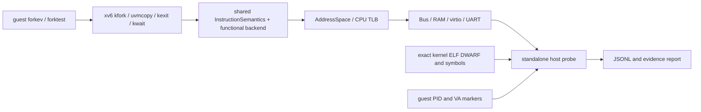

# U4：普通 xv6 fork 场景取证

## 范围与证据入口

本单元使用 1 hart、functional backend、virtio-blk、128 MiB RAM。内核是 U1 强制重建的 vendored xv6；独立场景镜像增加 `forkev`，仅包含 README、init、sh、forktest 和该夹具，不冒充上游原始镜像。产品源码、vendored xv6、公共协议和前端均不修改。

- E-U4-001：既有精确启动实验，命令、实际 HEAD、源码及资产 SHA-256、时间与退出码见 [运行清单](system-software-evidence-c253dda/u4-runs.json) 的 `boot`。
- E-U4-002：既有完整 shell 实验，同一清单中的 `shell`；stdout/stderr 按清单内文件名存放于同目录。
- E-U4-003：独立 ordinary fork 场景，由 [host 探针](../../myCPU/tests/host/system_software_fork_evidence.cpp) 配合 [guest 夹具](../../myCPU/tests/guest/system_software_fork_evidence.c) 自动采集；结果见同一运行清单中的 `fork`。
- E-U4-004：独立镜像构建，[构建脚本](system-software-evidence-c253dda/u4-build.sh)、[首次夹具构建失败](system-software-evidence-c253dda/u4-build-first-failure.txt)、[成功构建](system-software-evidence-c253dda/u4-build-success.txt)。首次失败是 guest `%p` 参数类型与其 printf 声明不匹配，修正为指针后构建成功，不能算产品缺陷。

构建产物不进入 Git。复现先完成 U1 对应的 core/xv6 构建，再运行 `XV6_EVIDENCE_MARCH=rv64ima bash docs/reviews/system-software-evidence-c253dda/u4-build.sh /tmp/mycpu-u4-evidence`。本次显式使用 `rv64ima`，不能复用脚本默认 `rv64gc` 作为此次构建命令。脚本使用现有 xv6 的 user library 对象和 mkfs，在独立目录生成 ELF 与 fs.img；内核 ELF 的 DWARF 经 GDB 提取 proc/cpu/allocator 布局、枚举和符号。mkfs 仅接受 basename 或 `user/` 前缀路径，故库资产复制到独立目录后构建镜像。源码、确切资产和二进制哈希均记录于运行清单；临时资产可由该脚本取得，不能只依赖未归档的 `/tmp` 文件。

## 执行状态

三项实际运行均退出 0，保持原有限预算；没有产品修复或故障绕过。[证据完整性检查](system-software-evidence-c253dda/u4-validation.json) 实际解析最终 JSONL，确认 mapping 4 条、U 态 store 2 条、ZOMBIE 1 条、reclaimed 2 条、passed result 1 条，全部运行退出码为 0，所采源码和资产哈希均未变化。

| E-ID | argv 摘要，cwd=`myCPU/` | 退出码 | 宿主单调时钟耗时 | 结果与输出 |
| --- | --- | --- | --- | --- |
| E-U4-001 | `timeout 1200 ./tests/host/xv6_boot_smoke` | 0 | 0.017145 秒 | 精确 5000 步启动/profile 基线全部通过；stdout 为 boot banner，stderr 为空 |
| E-U4-002 | `timeout 1200 ./tests/host/xv6_shell_smoke` | 0 | 853.961125 秒 | 完整 16 条命令通过；[阶段日志](system-software-evidence-c253dda/u4-shell.stderr)，boot prompt 为 503.516 秒，forktest 为 33.649 秒，stressfs 为 112.965 秒；成功路径不输出完整 guest UART |
| E-U4-003 | `timeout 1200 ./tests/host/system_software_fork_evidence <kernel> <isolated-fs.img> <layout.txt>` | 0 | 501.935403 秒 | [10 条事件原始 JSONL](system-software-evidence-c253dda/u4-fork.stdout)，探针内部总耗时 501.916 秒，stderr 为空 |
| E-U4-004 | `timeout 120s env XV6_EVIDENCE_MARCH=rv64ima bash docs/reviews/system-software-evidence-c253dda/u4-build.sh /tmp/mycpu-u4-evidence`，cwd 为仓库根 | 0 | 未采集 | 构建硬上限 120 秒，stdout/stderr 原合并保存在 `/tmp/mycpu-u4-build.log`，完整文本已复制入报告包；命令与环境由主会话提供，不能用未采集耗时比较性能 |

运行清单的顶层 HEAD 为序列启动时 `1b54928fc0f1d2c7e39d2c9c781be4e9a43babc7`，没有逐次重新采样 HEAD。结束时为 `e4ab34b0ca87aa0526226410512cdd7595c40024`；期间 U2/U3 提交没有改变所采 core/xv6/本单元源码。依据保存的 reflog 时间和 shell 结束时间，fork 启动 HEAD 推断为 `e4ab34b`，该项明确是推断。每项实验仍有二进制、内核和镜像运行前后 SHA-256，所采源码前后逐文件比较为零变化。

GDB、RISC-V GCC/ld/nm 的实际版本、路径、文件 SHA-256 与查询命令见清单；mkfs 可执行文件/源码及 user library 对象的构建后指纹亦保留。首次失败的完整编译诊断已保存，但未保存当时 guest 全文及指纹，不能声称可以完整重建那次历史构建。

完整 shell 使用原测试的全部 16 条命令：`ls`、`cat README`、`wc README`、`grep qemu README | wc`、文件写入/读回/删除/缺失读取、目录创建/嵌套文件写入/读回/删除/目录删除/缺失读取、`forktest`、`stressfs`。本次没有删减命令或放宽断言。其源码显式选择 functional，boot 上限 5 亿步；各命令使用源码的独立输出/prompt 步数上限（例如 forktest 为 5000 万/2000 万步），外层总墙钟为 1200 秒。不能把它记为 pipeline 场景通过。

独立探针亦仅使用 functional；boot 为 5 亿步，每段 BEFORE/AFTER/REAP 前缀最多 1 亿步、完整行最多 100 万步，回到 prompt 最多 2000 万步；后续 forktest 输出/prompt 为 5000 万/2000 万步。进程由外层 `timeout 1200` 限制，总墙钟也在探针每百万步检查一次。

## 场景检查点与预期

现有 `forktest.c:23–46` 只检验 fork 的资源上限与 wait 的数量，没有父子写入隔离断言。因此保留该测试并增加两页最小夹具。两页是 exec 已映射的独立 page-aligned BSS，父进程在 fork 前写入，避免依赖 lazy allocation 或固定 PID。

| 顺序 | 同步点 | 自动断言与取证 |
| --- | --- | --- |
| 1 | 父预写，fork；子打印 `BEFORE` 完整行 | 父子 PID 和 VA 从 guest 输出取得；从 proc 找 parent/root，读取实时三级 PTE；两页同 VA、不同 root 与 PA，值都继承父内容 |
| 2 | 子 U 态提交两次 store | host 在每次 functional step 后检查刷新后的 `last_access`；匹配子 PA、8 字节值、U 态发起 PC、child SATP root 和当前 proc；输出 `user_store` |
| 3 | 子打印 `AFTER` 完整行，尚未 exit | 父两页原值不变，子两页已改值，PA 沿用 BEFORE 时刻；输出 `mapping` |
| 4 | 子 exit 到内核 `sched` 入口 | 由本次内核符号定位，当前 proc 为子，state 为 ZOMBIE，xstate 为 37；输出 `zombie` |
| 5 | 父 wait 返回并校验，打印 `REAP` | guest 断言返回 child PID/status=37、父数据不变、再次 wait=-1；host 断言原 child slot 为 UNUSED、PID/root 归零，两张已观察子用户页为 kmem.freelist 成员 |
| 6 | 回到 shell 后运行现有 forktest | 要求 `fork test OK` 和新 shell prompt，在同一次 boot 内完成 |

UART 完整行是检查点，host 在最后一字节输出时暂停；父 wait 不能在子 `AFTER`/exit 之前回收子页。检查点不依赖调度先后或预设 PID。页回收只针对两张已观察用户页；xv6 的每槽 kernel stack 为长期对象，不要求清零或总内存计数归零。

## 实测映射与时间线

guest 输出取得父 PID 3、子 PID 4。BEFORE 和 AFTER 时刻父 root 均为 `0x87f25000`，子 root 均为 `0x87f54000`；本次两个被观察页的叶 PTE 都具有 `V/R/W/U/A/D`、没有 X。AFTER 映射和 PTE 与 BEFORE 相同，只改变子内容。

| 相同用户 VA | 父 PA / PTE | 子 PA / PTE | BEFORE 父、子值 | AFTER 父值 | AFTER 子值 |
| --- | --- | --- | --- | --- | --- |
| `0x2000` | `0x87f1e000` / `0x21fc78d7` | `0x87f29000` / `0x21fca4d7` | `0x11223344` | `0x11223344` | `0xaabbccdd` |
| `0x3000` | `0x87f1d000` / `0x21fc74d7` | `0x87f2a000` / `0x21fca8d7` | `0x55667788` | `0x55667788` | `0xeeff0011` |

| 顺序 | 自动事件 | cycle / instret 或保留边界 |
| --- | --- | --- |
| 1 | BEFORE 两页已复制并继承值 | `434550710 / 434550627` |
| 2 | 子 U 态 PC=`0xe8` 的 8 字节 store 到 `0x87f29000`，对应 VA=`0x2000` | `434568484 / 434568401`；SATP=`0x8000000000087f54` |
| 3 | 子 U 态 PC=`0xfc` 的 8 字节 store 到 `0x87f2a000`，对应 VA=`0x3000` | `434568489 / 434568406`；同一 child SATP |
| 4 | AFTER 子值改变、父值不变 | `435337009 / 435336887` |
| 5 | 子进入 `sched`，PC=`0x80002ac0`，ZOMBIE/status=37 | cycle=`435391372`；该事件未输出 instret |
| 6 | 父 wait 及校验完成；原 child slot UNUSED、PID/root=0；`0x87f29000`、`0x87f2a000` 都在 freelist | `reclaimed` 两条事件未输出 cycle/instret，不能捏造回收的精确周期 |
| 7 | 回到 shell、同一次 boot 的现有 forktest 成功，再次到 shell | `result.passed=true`，`existing_forktest=true` |

SATP 的原 JSONL 数字为 `9223372036855332692`，64 位字段使用任意精度整数解析。JavaScript `Number`/常规 `JSON.parse` 可能舍入该值；报告中的十六进制按精确整数换算。本探针文本不是生产协议契约。

因此本轮 ordinary fork 的两页继承、独立物理页、子写父不变、exit/status/wait 及用户页回收场景成立。这个结论仅覆盖本次 functional、1 hart、指定 xv6 与夹具；既有 boot/shell 通过不构成 pipeline、COW、真实 OS 性能或所有进程行为的证据。本单元未复现产品缺陷。

## 自动字段与解释边界

JSONL 的 PID/VA 起源于 guest 标记；proc 状态、parent 指针、page-table root、PTE、PA、内容与 allocator 成员起源于暂停时 RAM。实际 U 态 store 的 PC、SATP、PA、cycle、instret 起源于 host 对 CPU/Bus 的逐步观察。断言及 `result.passed` 由探针自动产生；源码关于 fork/wait 的含义、职责归属和覆盖范围由报告解释，不是生产协议自动输出。

这里的 PTE 是 RAM 中的当前表项。实际 store 记录到的 PA 与 child SATP 是独立执行证据；本探针没有导出 TLB entry、命中/缺失、逐级 walk 事件或 fault/trap 链，不能把 RAM PTE 当作完整 TLB 实时状态。没有故障注入、COW 或性能收益实验。

host 物理读取严格限制为无副作用 RAM，并使用 `source=evidence` 的内部标记，会覆盖 `last_access`，不冒充生产无副作用查询契约。每次新的 guest step 会刷新 fetch/data access；探针观察 store 后才读 proc，不用自身读取伪造 guest store。它没有修改 CPU/MMU 的语义，但确实新增了专用解释器和收集器。

## 职责与版本依赖

CPU/MMU 负责指令、特权、翻译和物理访问事实；平台负责磁盘/UART/中断；xv6 `kfork` 调用 `uvmcopy` 为已有页分配并复制物理页，`kexit` 赋 ZOMBIE/status，`kwait` 执行 `freeproc`。PID、父子关系、页归属和资源回收含义依赖 xv6 解释，当前由 standalone host 探针承担；生产 debug 协议与前端没有因此获得 PID/fork 自动关联。

后续 xv6 适配必须显式依赖：本次 ELF 符号和 DWARF、proc 数组长度和结构字段、cpu.proc、procstate 枚举、kmem.freelist/run.next、Sv39 布局与直接映射 RAM、guest 标记或系统调用识别。探针从 exact ELF 提取这些字段，不硬编码版本地址；这仍是版本依赖，不等于已实现通用 OS 适配框架。
